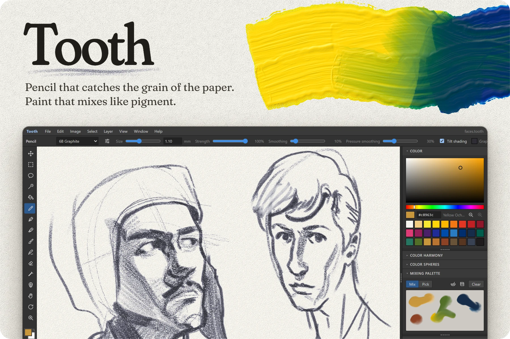
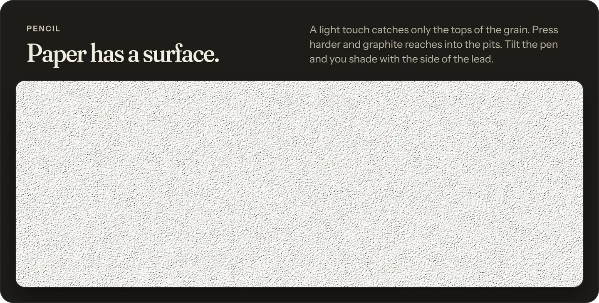
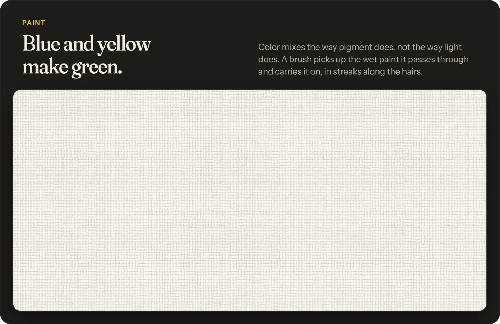
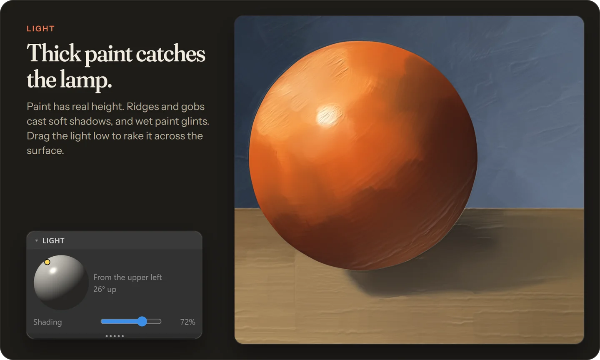
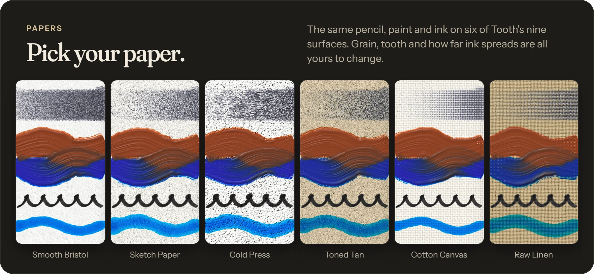
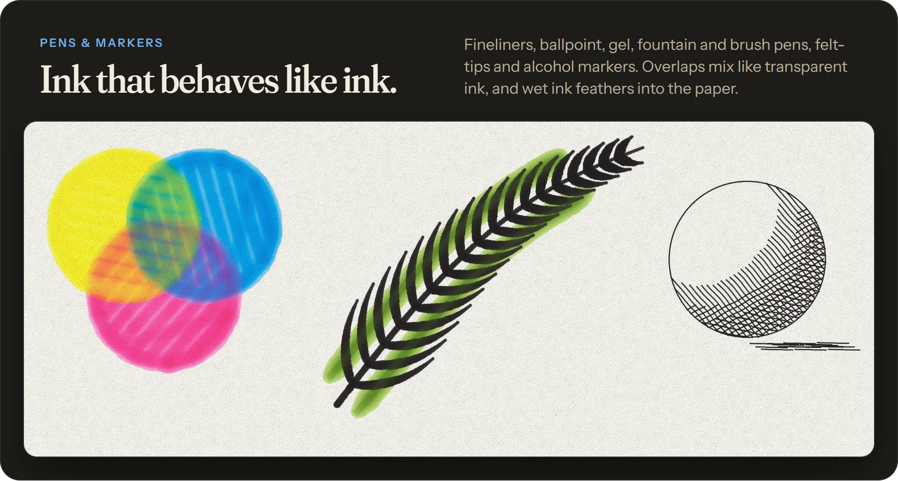
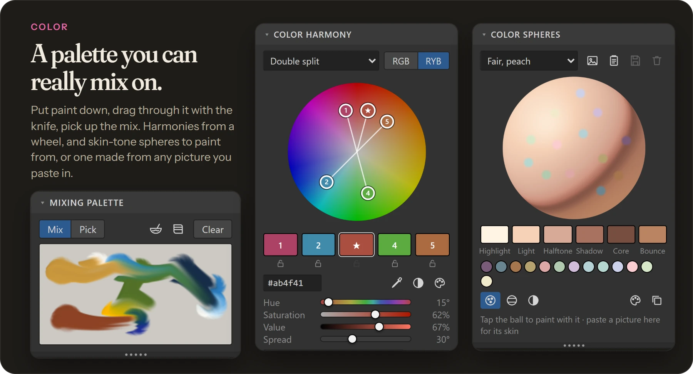
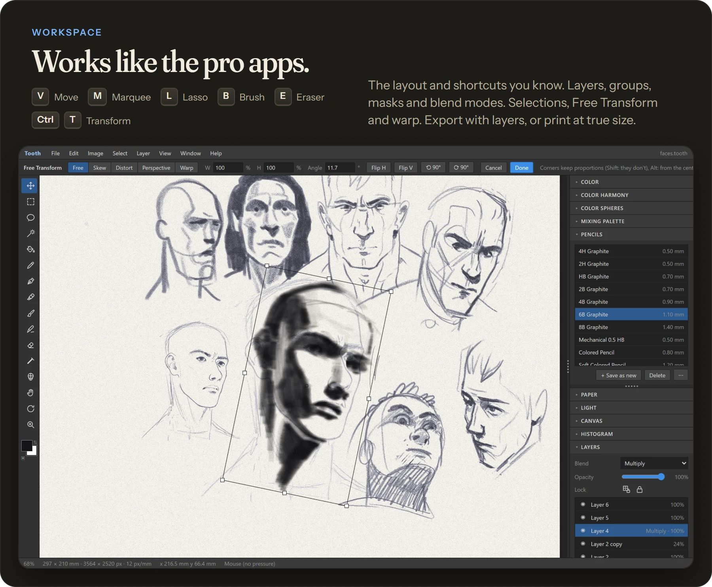
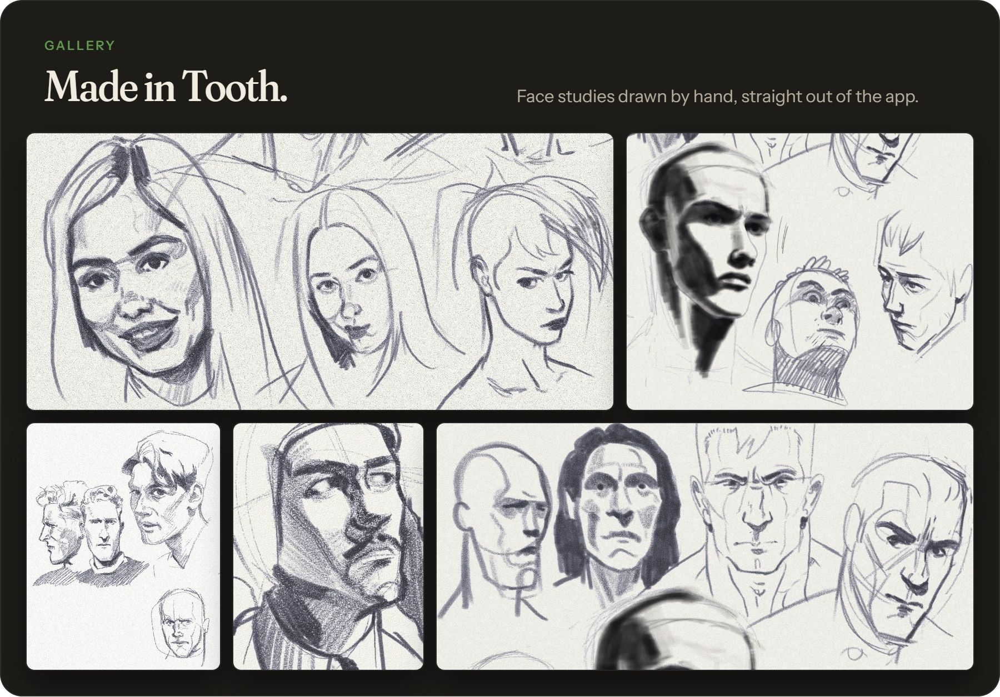

64-bit Windows 10 or 11 · installs without an admin password · install notes at the end of this page

## Installing

1. Get the installer (`Tooth_..._x64-setup.exe`) from the [latest release](https://github.com/vectorvinnie/Tooth-releases/releases/latest), and open it.
2. Windows may say "Windows protected your PC", because the app isn't from a big publisher. Click **More info**, then **Run anyway**.
3. It installs just for you and puts Tooth on the Start menu and the desktop.

**Drawing tablet:** pressure and tilt come through Windows Ink, so turn that on in your tablet's driver settings. The status bar at the bottom of Tooth shows live pressure and tilt while the pen hovers, so you can check it works.

**Updates:** when a new version is out, Tooth offers it when you open it. *Help > Check for Updates* looks by hand.

**Uninstalling:** *Settings > Apps > Installed apps > Tooth > Uninstall.*

<b>What else is in there</b>

- **Erasers:** kneaded lifts just the tops of the grain, block is strong, and the eraser pen is crisp, down to the paper
- **Blending stump, water bowl and towel:** smudge graphite, thin your paint, dry the brush
- **Paint that dries:** stays workable, goes tacky, then dry, even while the file is closed
- **Fills and gradients**, magic wand and quick selection, feathered selections
- **Symmetry:** mirrored, radial and mandala
- **Checking your drawing:** flip the view, value check, a histogram, a Loomis head guide, a measure tool and sticky notes
- **Real units:** documents in millimetres, and a view at the page's true size on your monitor
- **History brush and snapshots**
- **Your own presets:** tune any brush, pen or pencil, keep presets in folders, and share them as files
- **Floating panels and workspaces**, dark and light themes
- **Files:** PNG, JPEG and WebP, plus layered .psd and .ora files

